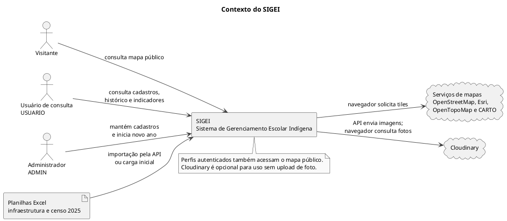

# Contexto do SIGEI

Visão do sistema e de seus participantes externos. Adequada à apresentação da solução.

## Fontes no projeto

- [app.routes.ts](../../sigei-frontend/src/app/app.routes.ts)
- [SecurityConfig.java](../../sigei-backend/src/main/java/ac/gov/br/sigei_backend/config/security/SecurityConfig.java)
- [CloudinaryService.java](../../sigei-backend/src/main/java/ac/gov/br/sigei_backend/service/armazenamento/CloudinaryService.java)
- [mapa-publico.component.ts](../../sigei-frontend/src/app/features/mapa-publico/pages/mapa-publico/mapa-publico.component.ts)
