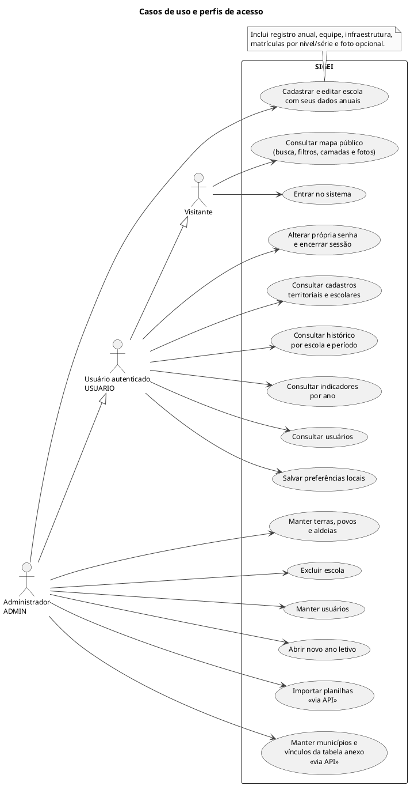

# Casos de uso e perfis de acesso

Funcionalidades existentes, com distinção entre consulta pública, consulta autenticada e manutenção.

## Leitura e limites

A autenticação é precondição das funções restritas. A herança dos atores representa capacidades acumuladas. O perfil temporário `ROLE_TROCAR_SENHA` precisa trocar a senha antes de acessar as consultas restritas. A interface de municípios é de consulta; a API oferece manutenção. Preferências são gravadas no navegador. Não há exportação de relatórios em arquivo implementada.

## Fontes no projeto

- [SecurityConfig.java](../../sigei-backend/src/main/java/ac/gov/br/sigei_backend/config/security/SecurityConfig.java)
- [admin.routes.ts](../../sigei-frontend/src/app/features/admin/admin.routes.ts)
- [configuracoes.component.ts](../../sigei-frontend/src/app/features/admin/configuracoes/pages/configuracoes/configuracoes.component.ts)
- [ImportacaoExcelController.java](../../sigei-backend/src/main/java/ac/gov/br/sigei_backend/controllers/importacao/ImportacaoExcelController.java)
