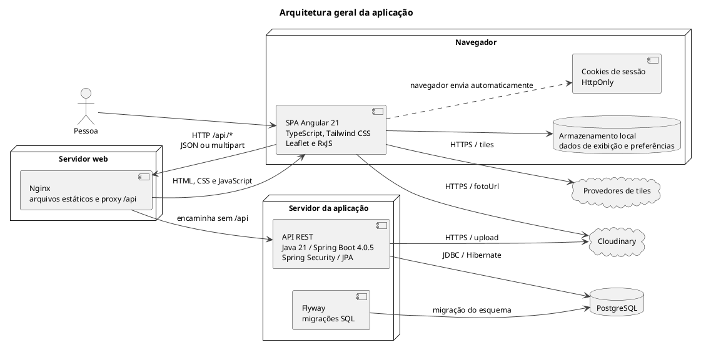

# Arquitetura geral da aplicação

Visão lógica da SPA, do servidor HTTP, da API e da persistência. Os elementos representam unidades de execução, sem pressupor uma infraestrutura de nuvem específica.

## Leitura e limites

Os tokens não são armazenados no `localStorage`. O estado local orienta a navegação; o backend decide a autorização. O Nginx fornecido atende HTTP; terminação TLS depende do ambiente de implantação.

## Fontes no projeto

- [package.json](../../sigei-frontend/package.json)
- [default.conf.template](../../sigei-frontend/nginx/default.conf.template)
- [pom.xml](../../sigei-backend/pom.xml)
- [application.properties](../../sigei-backend/src/main/resources/application.properties)
