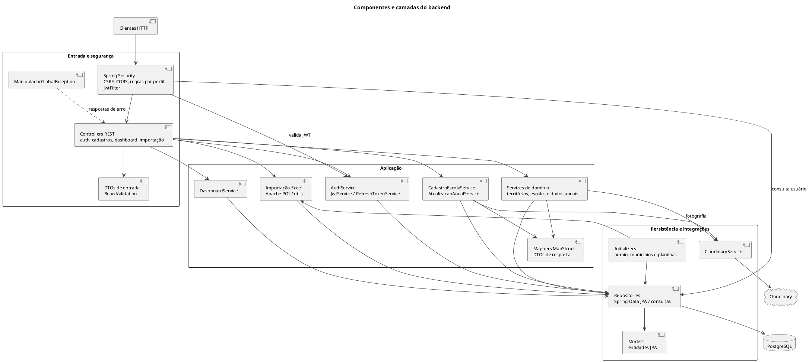

# Componentes e camadas do backend

Responsabilidades e dependências principais do monólito Spring Boot.

## Leitura e limites

Agrupamentos representam camadas e conjuntos de classes, não microserviços. `CadastroEscolaService` coordena a gravação do agregado escolar; `DashboardService` consulta projeções e agregações.

## Fontes no projeto

- [EscolaController.java](../../sigei-backend/src/main/java/ac/gov/br/sigei_backend/controllers/EscolaController.java)
- [CadastroEscolaService.java](../../sigei-backend/src/main/java/ac/gov/br/sigei_backend/service/CadastroEscolaService.java)
- [DashboardService.java](../../sigei-backend/src/main/java/ac/gov/br/sigei_backend/service/DashboardService.java)
- [SecurityConfig.java](../../sigei-backend/src/main/java/ac/gov/br/sigei_backend/config/security/SecurityConfig.java)
- [ManipuladorGlobalException.java](../../sigei-backend/src/main/java/ac/gov/br/sigei_backend/exceptions/handler/ManipuladorGlobalException.java)
