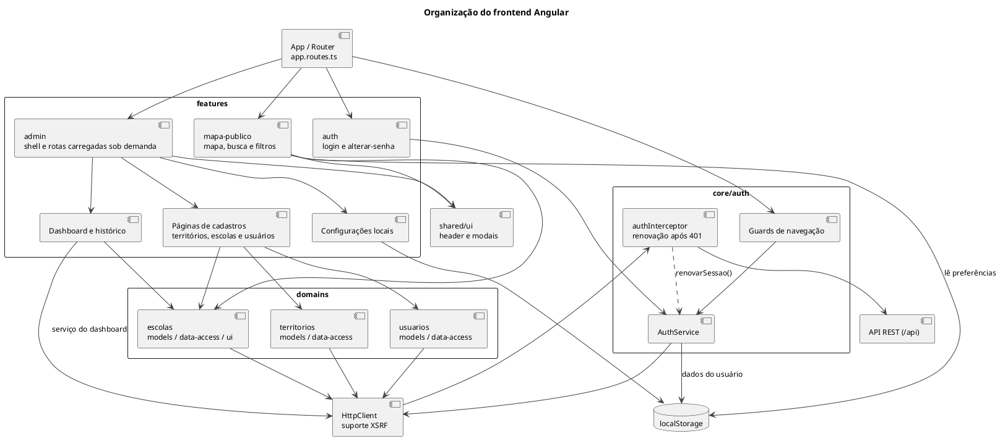

# Organização do frontend Angular

Separação entre funcionalidades, serviços de domínio, autenticação e componentes compartilhados.

## Leitura e limites

As páginas são componentes standalone. Os guards controlam a navegação e a exibição de ações; as regras efetivas de segurança são aplicadas pela API. Nem toda preferência armazenada implica comportamento implementado em todas as telas.

## Fontes no projeto

- [app.routes.ts](../../sigei-frontend/src/app/app.routes.ts)
- [app.config.ts](../../sigei-frontend/src/app/app.config.ts)
- [admin.routes.ts](../../sigei-frontend/src/app/features/admin/admin.routes.ts)
- [auth.interceptor.ts](../../sigei-frontend/src/app/core/auth/auth.interceptor.ts)
