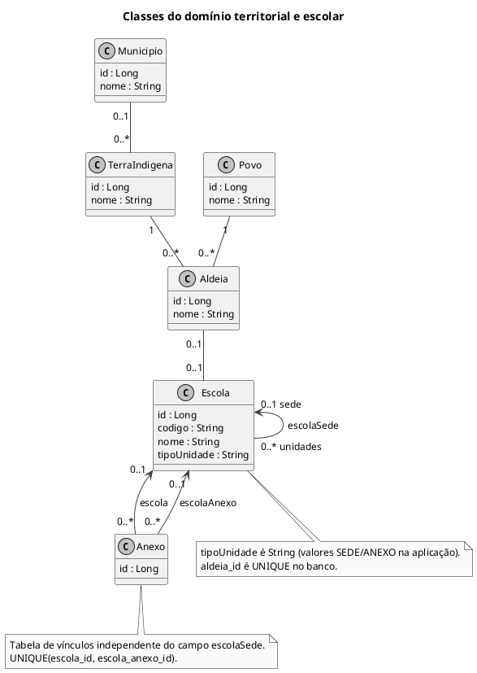

# Classes do domínio territorial e escolar

Atributos escalares e associações persistentes. Métodos de acesso foram omitidos para legibilidade.

## Leitura e limites

Multiplicidades seguem a nulabilidade e unicidade persistidas. A entrada do cadastro completo exige aldeia, embora a coluna permita nulo. O cadastro completo usa `escolaSede`; a entidade `Anexo` também existe, com API própria. Não se presume sincronização automática entre as duas representações.

## Fontes no projeto

- [Escola.java](../../sigei-backend/src/main/java/ac/gov/br/sigei_backend/models/Escola.java)
- [Aldeia.java](../../sigei-backend/src/main/java/ac/gov/br/sigei_backend/models/Aldeia.java)
- [TerraIndigena.java](../../sigei-backend/src/main/java/ac/gov/br/sigei_backend/models/TerraIndigena.java)
- [Anexo.java](../../sigei-backend/src/main/java/ac/gov/br/sigei_backend/models/Anexo.java)
