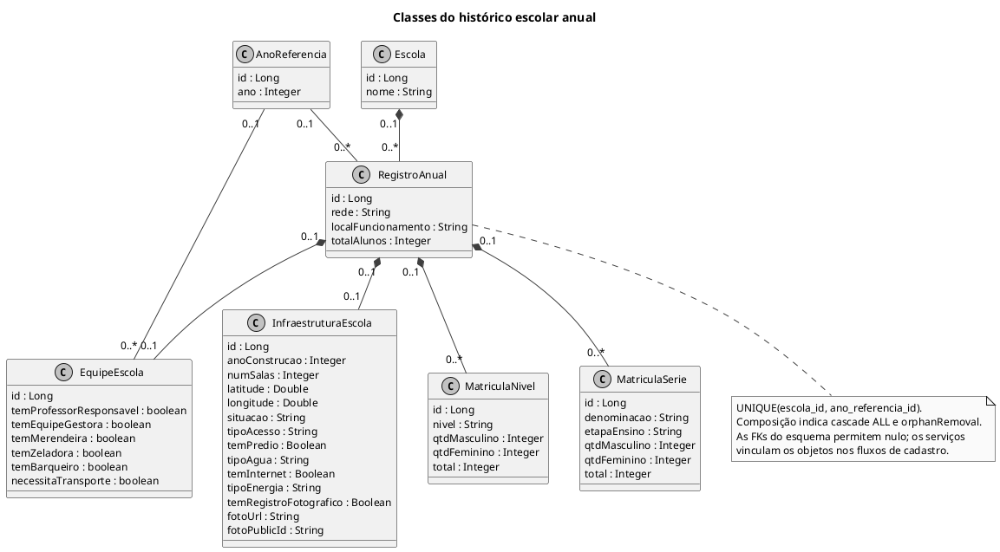

# Classes do histórico escolar anual

O registro anual reúne dados de equipe, infraestrutura e matrículas de uma escola em um ano.

## Fontes no projeto

- [RegistroAnual.java](../../sigei-backend/src/main/java/ac/gov/br/sigei_backend/models/RegistroAnual.java)
- [EquipeEscola.java](../../sigei-backend/src/main/java/ac/gov/br/sigei_backend/models/EquipeEscola.java)
- [InfraestruturaEscola.java](../../sigei-backend/src/main/java/ac/gov/br/sigei_backend/models/InfraestruturaEscola.java)
- [MatriculaNivel.java](../../sigei-backend/src/main/java/ac/gov/br/sigei_backend/models/MatriculaNivel.java)
- [MatriculaSerie.java](../../sigei-backend/src/main/java/ac/gov/br/sigei_backend/models/MatriculaSerie.java)
