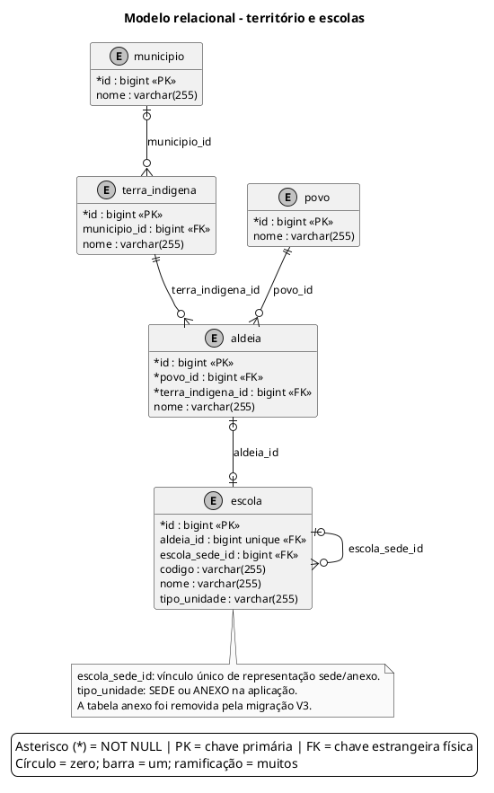

# Modelo relacional - território e escolas

Estrutura territorial e vínculo entre escolas-sede e anexos, com todas as colunas das cinco tabelas.

Atualizado em **06/10/2026**, considerando o estado resultante das migrações **V1 a V6** e os mapeamentos atuais das entidades.

## Leitura e limites

**Convenções:** `*` indica coluna obrigatória (NOT NULL, incluindo a chave primária); ausência de `*` indica coluna anulável. `PK` = chave primária; `FK` = chave estrangeira física; `unique`/`UNIQUE` = unicidade. No pé de galinha, círculo = zero, barra = um e ramificação = muitos. Toda FK referencia a coluna `id` da tabela na outra extremidade. Campos de auditoria que apenas copiam identificadores não são marcados como FK.

- A migração V3 removeu a tabela `anexo`. O vínculo agora é representado somente por `escola.escola_sede_id`, que referencia outra linha de `escola`.
- Uma escola pode ter zero ou uma sede; a mesma sede pode ser referenciada por várias escolas. As regras sobre os tipos SEDE/ANEXO são verificadas pela aplicação; a FK, isoladamente, não impõe esses tipos.
- `tipo_unidade` continua `varchar(255)`, sem enum nativo ou CHECK de valores definido nas migrações.
- `escola.aldeia_id` é UNIQUE e anulável: cada escola se vincula a no máximo uma aldeia, e uma aldeia pode ter no máximo uma escola nesse esquema.
- As cinco tabelas são auditadas. Suas versões estão no [ER de auditoria territorial](21-er-auditoria-territorio.md).

## Fontes no projeto

- [V1__esquema_inicial.sql](../../sigei-backend/src/main/resources/db/migration/V1__esquema_inicial.sql)
- [V3__unifica_vinculo_sede_anexo.sql](../../sigei-backend/src/main/resources/db/migration/V3__unifica_vinculo_sede_anexo.sql)
- [Escola.java](../../sigei-backend/src/main/java/ac/gov/br/sigei_backend/models/Escola.java)
- [Aldeia.java](../../sigei-backend/src/main/java/ac/gov/br/sigei_backend/models/Aldeia.java)
- [VinculoSedeService.java](../../sigei-backend/src/main/java/ac/gov/br/sigei_backend/service/VinculoSedeService.java)
