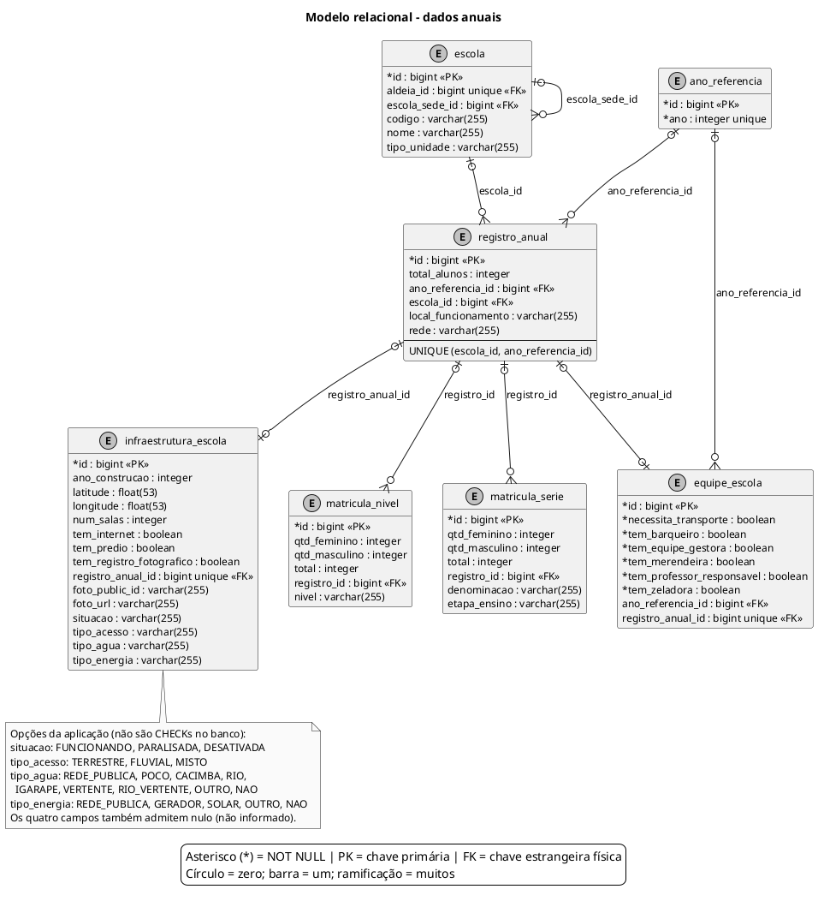

# Modelo relacional - dados anuais

Dados escolares por ano, incluindo os domínios de valores da infraestrutura. A tabela escola é repetida integralmente para explicitar a origem do vínculo.

Atualizado em **06/10/2026**, considerando o estado resultante das migrações **V1 a V6** e os mapeamentos atuais das entidades.

## Leitura e limites

**Convenções:** `*` indica coluna obrigatória (NOT NULL, incluindo a chave primária); ausência de `*` indica coluna anulável. `PK` = chave primária; `FK` = chave estrangeira física; `unique`/`UNIQUE` = unicidade. No pé de galinha, círculo = zero, barra = um e ramificação = muitos. Toda FK referencia a coluna `id` da tabela na outra extremidade. Campos de auditoria que apenas copiam identificadores não são marcados como FK.

- `UNIQUE (escola_id, ano_referencia_id)` impede duplicar a combinação de escola e ano quando ambos estão preenchidos. As FKs continuam anuláveis no SQL.
- As FKs únicas de equipe e infraestrutura permitem no máximo uma linha de cada uma por registro anual. O campo `equipe_escola.ano_referencia_id` permanece no esquema.
- Não há UNIQUE por nível ou série no SQL. A existência de validações da aplicação não é representada como restrição física inexistente.
- `SituacaoEscola`, `TipoAcesso`, `TipoAgua` e `TipoEnergia` definem opções na aplicação. Os quatro atributos continuam `String` na entidade e `varchar(255)` anulável no PostgreSQL; não existem tabelas auxiliares, tipos ENUM nativos nem CHECK dessas opções nas migrações V1–V6.
- `OpcoesInfraestrutura.validar` normaliza entradas e rejeita valores inválidos na gravação pela API. Vazio é convertido para nulo. Na importação, valores não reconhecidos são convertidos para nulo.
- V5 normaliza situação/acesso e V6 normaliza água/energia, registrando as correções em `infraestrutura_escola_aud`. As tabelas temporárias dessas migrações não fazem parte do modelo persistente.
- As versões dos dados anuais estão no [ER de auditoria anual](22-er-auditoria-dados-anuais.md).

## Fontes no projeto

- [V1__esquema_inicial.sql](../../sigei-backend/src/main/resources/db/migration/V1__esquema_inicial.sql)
- [V5__padroniza_situacao_e_acesso.sql](../../sigei-backend/src/main/resources/db/migration/V5__padroniza_situacao_e_acesso.sql)
- [V6__padroniza_agua_e_energia.sql](../../sigei-backend/src/main/resources/db/migration/V6__padroniza_agua_e_energia.sql)
- [InfraestruturaEscola.java](../../sigei-backend/src/main/java/ac/gov/br/sigei_backend/models/InfraestruturaEscola.java)
- [SituacaoEscola.java](../../sigei-backend/src/main/java/ac/gov/br/sigei_backend/models/enums/SituacaoEscola.java)
- [TipoAcesso.java](../../sigei-backend/src/main/java/ac/gov/br/sigei_backend/models/enums/TipoAcesso.java)
- [TipoAgua.java](../../sigei-backend/src/main/java/ac/gov/br/sigei_backend/models/enums/TipoAgua.java)
- [TipoEnergia.java](../../sigei-backend/src/main/java/ac/gov/br/sigei_backend/models/enums/TipoEnergia.java)
- [OpcoesInfraestrutura.java](../../sigei-backend/src/main/java/ac/gov/br/sigei_backend/utils/OpcoesInfraestrutura.java)
