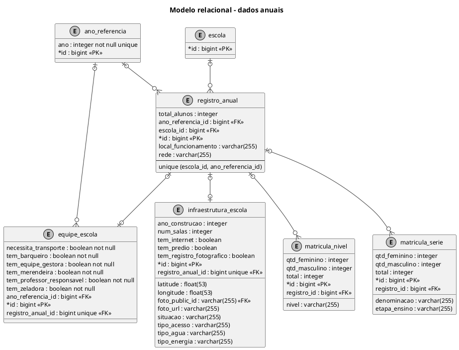

# Modelo relacional - dados anuais

Segunda parte do modelo físico. A tabela escola é repetida de forma resumida para mostrar a ligação com o território.

## Leitura e limites

Modelo físico derivado das migrações Flyway. `PK` = chave primária; `FK` = chave estrangeira; `unique` = unicidade; `not null` = preenchimento obrigatório. No pé de galinha, círculo significa zero, barra significa um e ramificação significa muitos. A ausência de `not null` indica coluna anulável. Tabelas de apoio repetidas entre figuras são a mesma tabela física. Não existem restrições UNIQUE para nível ou série no SQL; a validação de itens repetidos no cadastro completo é feita pelo serviço.

## Fontes no projeto

- [V1__esquema_inicial.sql](../../sigei-backend/src/main/resources/db/migration/V1__esquema_inicial.sql)
- [V2__refresh_token.sql](../../sigei-backend/src/main/resources/db/migration/V2__refresh_token.sql)
