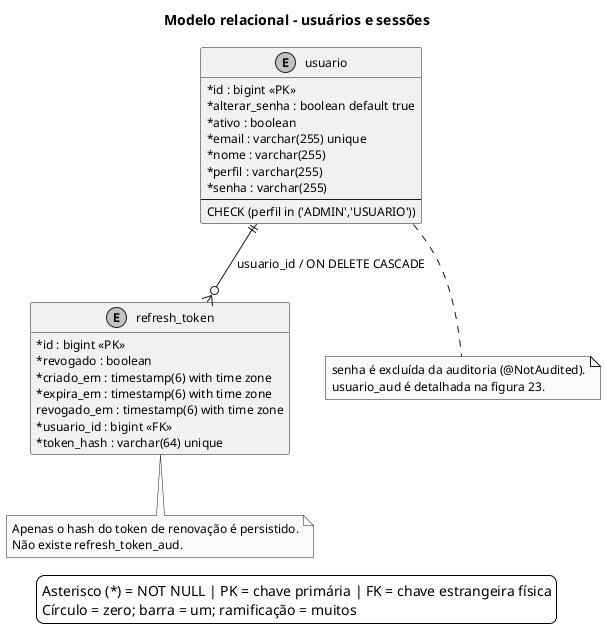

# Modelo relacional - usuários e sessões

Usuários e tokens de renovação. As tabelas de versões de usuários são apresentadas separadamente da persistência das sessões.

Atualizado em **06/10/2026**, considerando o estado resultante das migrações **V1 a V6** e os mapeamentos atuais das entidades.

## Leitura e limites

**Convenções:** `*` indica coluna obrigatória (NOT NULL, incluindo a chave primária); ausência de `*` indica coluna anulável. `PK` = chave primária; `FK` = chave estrangeira física; `unique`/`UNIQUE` = unicidade. No pé de galinha, círculo = zero, barra = um e ramificação = muitos. Toda FK referencia a coluna `id` da tabela na outra extremidade. Campos de auditoria que apenas copiam identificadores não são marcados como FK.

- Uma sessão de renovação pertence obrigatoriamente a um usuário; um usuário pode ter zero ou várias sessões. A FK usa `ON DELETE CASCADE`.
- `usuario.perfil` possui CHECK com os valores ADMIN/USUARIO, diferentemente dos domínios de infraestrutura que são validados na aplicação.
- `usuario.senha` guarda o hash produzido pelo PasswordEncoder. `refresh_token.token_hash` guarda o SHA-256 do token de renovação. O JWT de acesso não possui tabela própria.
- `Usuario` é auditado, mas `senha` tem `@NotAudited` e não existe em `usuario_aud`. `RefreshToken` não é auditado: não existe `refresh_token_aud`.
- A autoria de revisões usa cópias de identificação, sem FK de `revisao.usuario_id` para `usuario`; veja [auditoria de usuários e autoria](23-er-auditoria-usuarios.md).

## Fontes no projeto

- [V1__esquema_inicial.sql](../../sigei-backend/src/main/resources/db/migration/V1__esquema_inicial.sql)
- [V2__refresh_token.sql](../../sigei-backend/src/main/resources/db/migration/V2__refresh_token.sql)
- [V4__trilha_auditoria.sql](../../sigei-backend/src/main/resources/db/migration/V4__trilha_auditoria.sql)
- [Usuario.java](../../sigei-backend/src/main/java/ac/gov/br/sigei_backend/models/Usuario.java)
- [RefreshToken.java](../../sigei-backend/src/main/java/ac/gov/br/sigei_backend/models/RefreshToken.java)
- [Revisao.java](../../sigei-backend/src/main/java/ac/gov/br/sigei_backend/models/Revisao.java)
