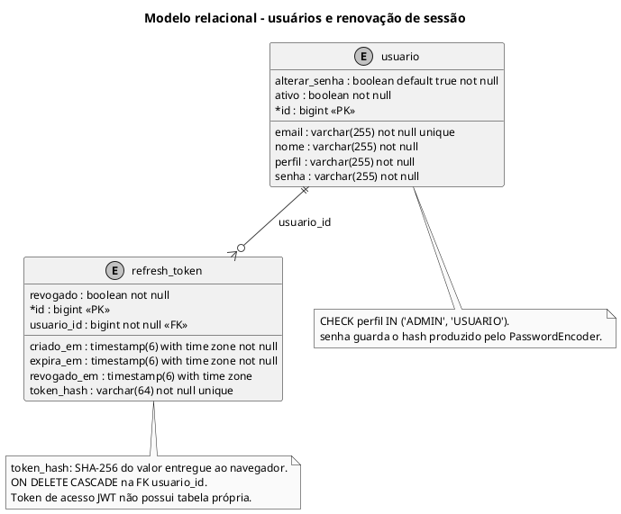

# Modelo relacional - usuários e renovação de sessão

Terceira parte do modelo físico, incluindo a migração V2.

## Leitura e limites

Modelo físico derivado das migrações Flyway. `PK` = chave primária; `FK` = chave estrangeira; `unique` = unicidade; `not null` = preenchimento obrigatório. No pé de galinha, círculo significa zero, barra significa um e ramificação significa muitos. A ausência de `not null` indica coluna anulável. Tabelas de apoio repetidas entre figuras são a mesma tabela física.

## Fontes no projeto

- [V1__esquema_inicial.sql](../../sigei-backend/src/main/resources/db/migration/V1__esquema_inicial.sql)
- [V2__refresh_token.sql](../../sigei-backend/src/main/resources/db/migration/V2__refresh_token.sql)
