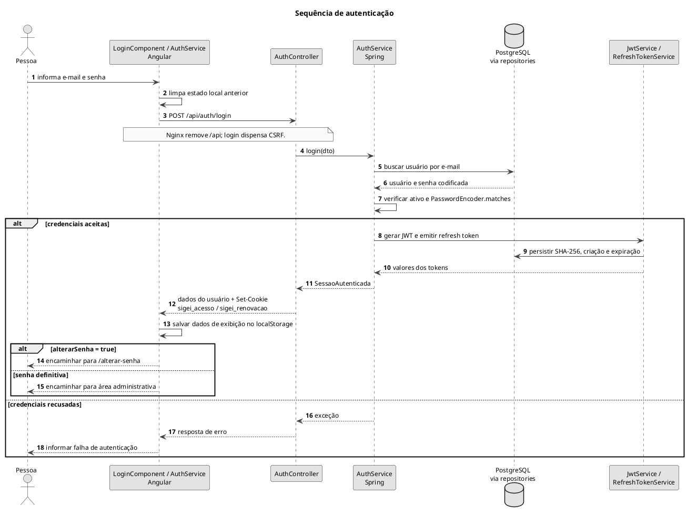

# Sequência de autenticação

Fluxo de entrada e encaminhamento conforme a necessidade de trocar a senha.

## Leitura e limites

Os cookies de sessão usam HttpOnly e SameSite=Strict; Secure é configurável. O código atual distingue erros: e-mail não encontrado resulta em 404, enquanto senha incorreta ou usuário desativado lançam RuntimeException. O diagrama não normaliza esses casos para um 401 inexistente no fluxo atual.

## Fontes no projeto

- [auth.service.ts](../../sigei-frontend/src/app/core/auth/auth.service.ts)
- [login.component.ts](../../sigei-frontend/src/app/features/auth/pages/login/login.component.ts)
- [AuthController.java](../../sigei-backend/src/main/java/ac/gov/br/sigei_backend/controllers/auth/AuthController.java)
- [AuthService.java](../../sigei-backend/src/main/java/ac/gov/br/sigei_backend/service/auth/AuthService.java)
- [RefreshTokenService.java](../../sigei-backend/src/main/java/ac/gov/br/sigei_backend/service/auth/RefreshTokenService.java)
