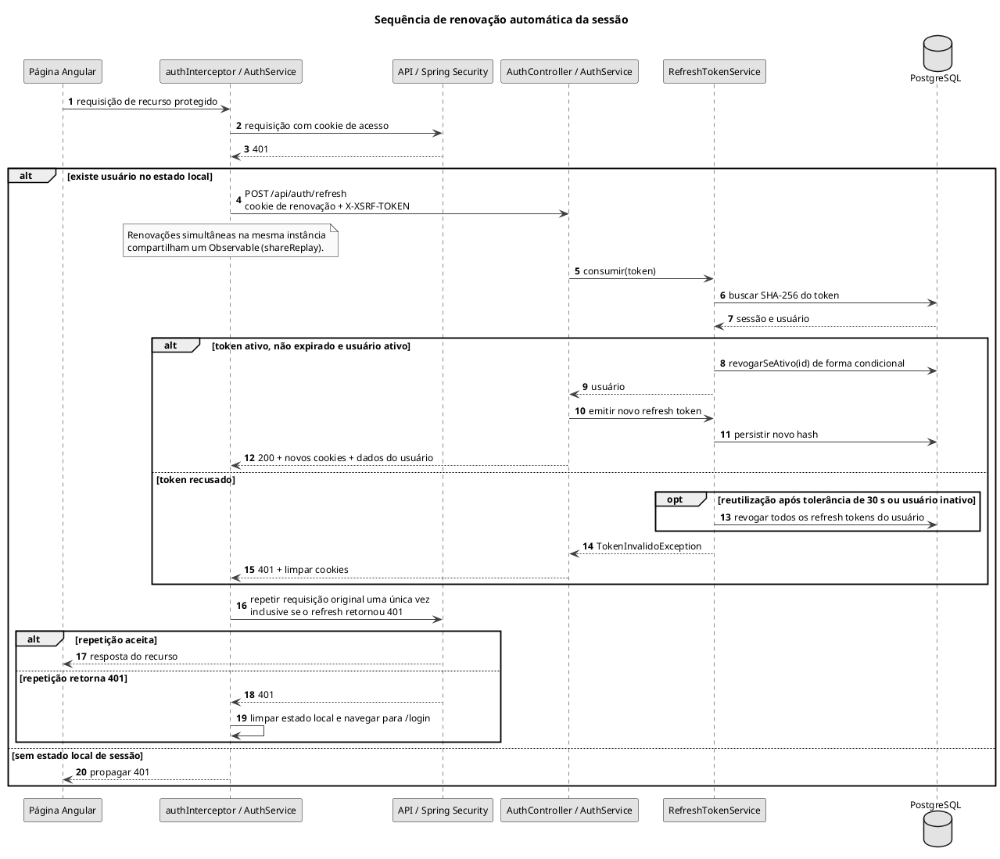

# Sequência de renovação automática da sessão

Tratamento de 401 pelo interceptor e rotação do refresh token.

## Leitura e limites

O retry após refresh recusado tenta acomodar renovação por outra aba. A tolerância de 30 segundos não aceita novamente o token consumido: recusa a renovação sem revogar todas as sessões. Falhas diferentes de 401 são propagadas conforme o interceptor. A revogação de refresh tokens não é uma lista de revogação dos JWTs já emitidos.

## Fontes no projeto

- [auth.interceptor.ts](../../sigei-frontend/src/app/core/auth/auth.interceptor.ts)
- [auth.service.ts](../../sigei-frontend/src/app/core/auth/auth.service.ts)
- [RefreshTokenService.java](../../sigei-backend/src/main/java/ac/gov/br/sigei_backend/service/auth/RefreshTokenService.java)
- [AuthController.java](../../sigei-backend/src/main/java/ac/gov/br/sigei_backend/controllers/auth/AuthController.java)
