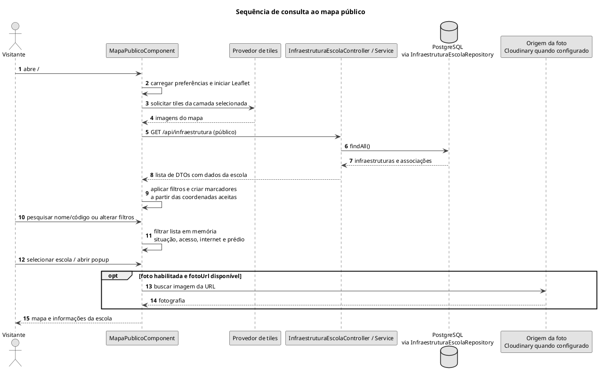

# Sequência de consulta ao mapa público

Carregamento de dados, tiles e aplicação de filtros no navegador.

## Leitura e limites

A consulta atual usa `findAll()` e não seleciona o último ano. Com mais de um registro anual, uma escola pode aparecer mais de uma vez. Filtros e busca não geram nova consulta à API. Não há serviço de geocodificação neste fluxo.

## Fontes no projeto

- [mapa-publico.component.ts](../../sigei-frontend/src/app/features/mapa-publico/pages/mapa-publico/mapa-publico.component.ts)
- [infraestrutura.service.ts](../../sigei-frontend/src/app/domains/escolas/data-access/infraestrutura.service.ts)
- [InfraestruturaEscolaService.java](../../sigei-backend/src/main/java/ac/gov/br/sigei_backend/service/InfraestruturaEscolaService.java)
- [SecurityConfig.java](../../sigei-backend/src/main/java/ac/gov/br/sigei_backend/config/security/SecurityConfig.java)
