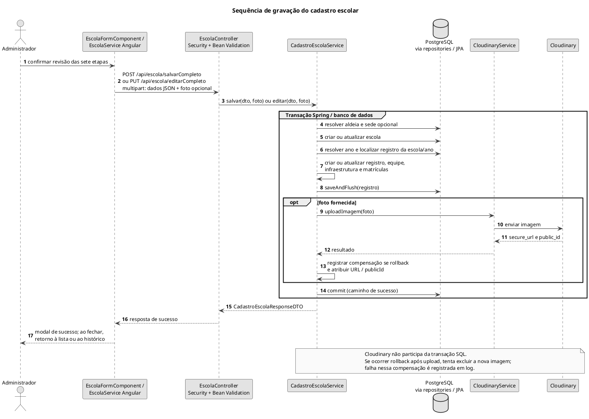

# Sequência de gravação do cadastro escolar

Criação ou edição do cadastro completo, com transação no banco e foto opcional.

## Leitura e limites

A figura mostra o caminho de sucesso e a compensação prevista. Cloudinary não configurado lança exceção de execução e a API responde 503. `@Transactional` não declara `rollbackFor = IOException.class`; portanto, não se afirma rollback para toda falha possível de I/O. Na edição, matrículas ausentes do payload são preservadas; os demais anos não são alterados.

## Fontes no projeto

- [escola.service.ts](../../sigei-frontend/src/app/domains/escolas/data-access/escola.service.ts)
- [EscolaController.java](../../sigei-backend/src/main/java/ac/gov/br/sigei_backend/controllers/EscolaController.java)
- [CadastroEscolaService.java](../../sigei-backend/src/main/java/ac/gov/br/sigei_backend/service/CadastroEscolaService.java)
- [CloudinaryService.java](../../sigei-backend/src/main/java/ac/gov/br/sigei_backend/service/armazenamento/CloudinaryService.java)
