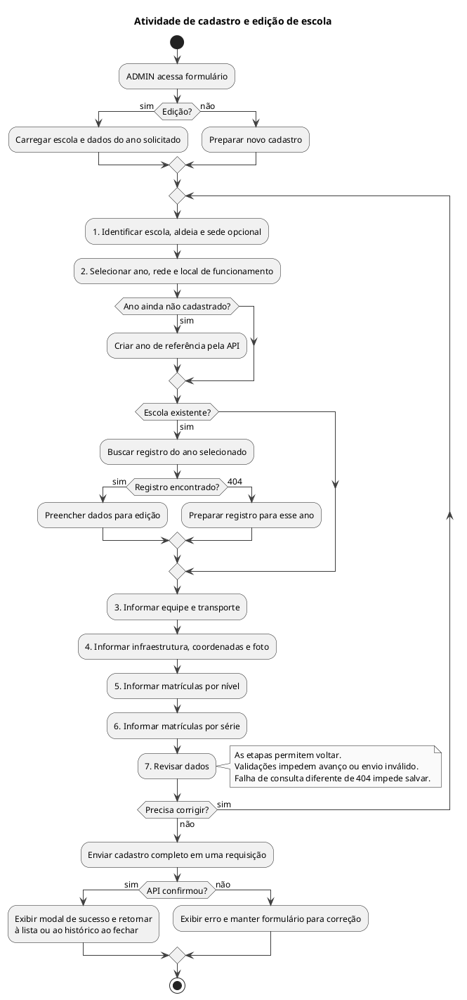

# Atividade de cadastro e edição de escola

Fluxo do formulário em sete etapas, incluindo seleção de ano na edição.

## Leitura e limites

O fluxo é uma síntese da interação, não uma enumeração de todos os eventos da tela. Criar um `AnoReferencia` pelo formulário é uma operação separada e não equivale à abertura global do próximo ano.

## Fontes no projeto

- [escola-form.component.ts](../../sigei-frontend/src/app/features/admin/escolas/pages/escola-form/escola-form.component.ts)
- [escola-form.component.html](../../sigei-frontend/src/app/features/admin/escolas/pages/escola-form/escola-form.component.html)
