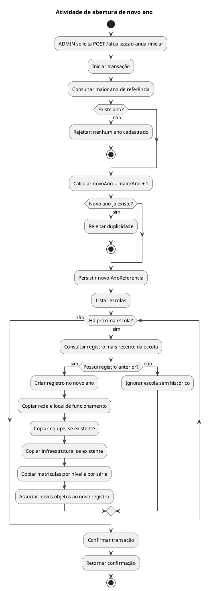

# Atividade de abertura de novo ano

Regra implementada por AtualizacaoAnualService, incluindo o comportamento de cópia.

## Leitura e limites

A origem é o registro mais recente **de cada escola**, mesmo que não pertença ao maior ano global. O código copia os quantitativos das matrículas. Não copia `RegistroAnual.totalAlunos`, `InfraestruturaEscola.fotoPublicId` nem atribui `EquipeEscola.anoReferencia`; copia `fotoUrl`. Esses detalhes descrevem a implementação existente e não uma proposta de regra de negócio.

## Fontes no projeto

- [AtualizacaoAnualService.java](../../sigei-backend/src/main/java/ac/gov/br/sigei_backend/service/AtualizacaoAnualService.java)
- [AtualizacaoAnualController.java](../../sigei-backend/src/main/java/ac/gov/br/sigei_backend/controllers/AtualizacaoAnualController.java)
- [atualizacao-anual.service.ts](../../sigei-frontend/src/app/domains/escolas/data-access/atualizacao-anual.service.ts)
