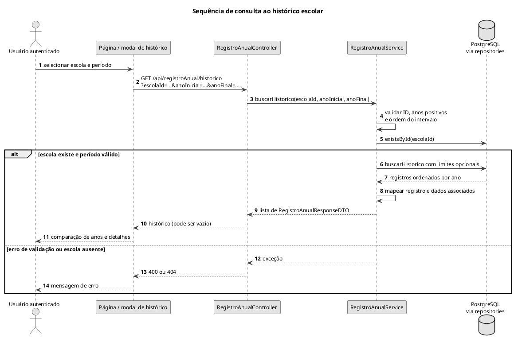

# Sequência de consulta ao histórico escolar

Consulta por escola e intervalo opcional, com validação e ordenação.

## Leitura e limites

Trata-se de histórico por ano de referência, não trilha de auditoria de alterações. A edição de um ano modifica seu registro; não cria automaticamente uma versão anterior dos valores alterados.

## Fontes no projeto

- [RegistroAnualService.java](../../sigei-backend/src/main/java/ac/gov/br/sigei_backend/service/RegistroAnualService.java)
- [RegistroAnualRepository.java](../../sigei-backend/src/main/java/ac/gov/br/sigei_backend/repository/RegistroAnualRepository.java)
- [historico-escolas.component.ts](../../sigei-frontend/src/app/features/admin/historico-escolas/pages/historico-escolas/historico-escolas.component.ts)
- [historico-escola-modal.component.ts](../../sigei-frontend/src/app/domains/escolas/ui/historico-escola-modal/historico-escola-modal.component.ts)
