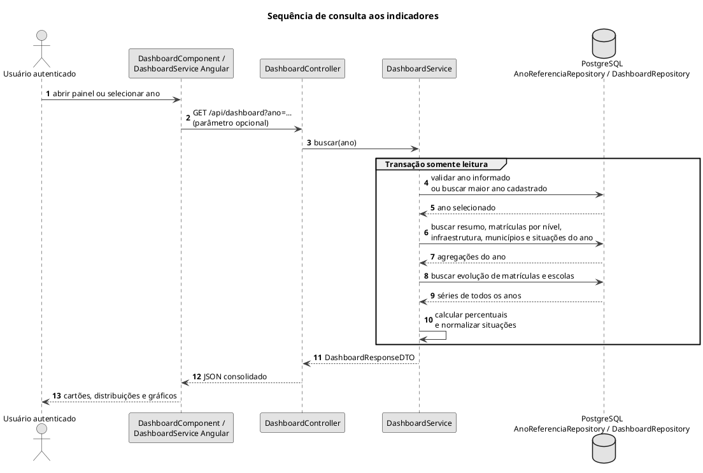

# Sequência de consulta aos indicadores

Consolidação de indicadores por ano e séries de evolução.

## Leitura e limites

As séries de evolução não se restringem ao ano selecionado. O ano informado deve existir; sem anos cadastrados a consulta falha. O painel exibe indicadores, sem endpoint de exportação de relatório em arquivo.

## Fontes no projeto

- [DashboardService.java](../../sigei-backend/src/main/java/ac/gov/br/sigei_backend/service/DashboardService.java)
- [DashboardRepository.java](../../sigei-backend/src/main/java/ac/gov/br/sigei_backend/repository/DashboardRepository.java)
- [DashboardController.java](../../sigei-backend/src/main/java/ac/gov/br/sigei_backend/controllers/dashboard/DashboardController.java)
- [dashboard.service.ts](../../sigei-frontend/src/app/features/admin/dashboard/data-access/dashboard.service.ts)
