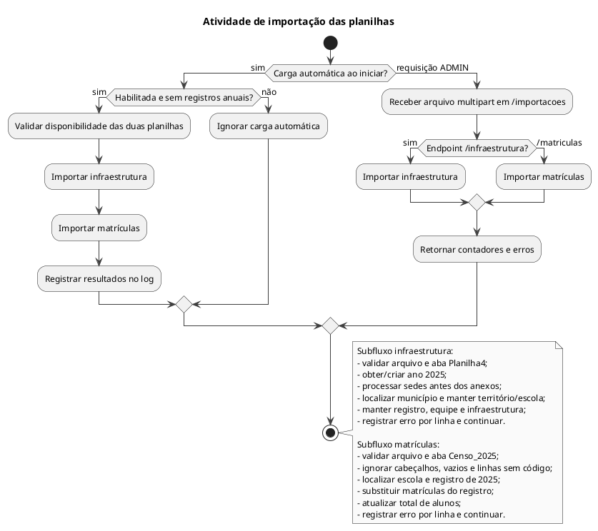

# Atividade de importação das planilhas

Visão dos dois importadores e da carga automática inicial.

## Leitura e limites

Layouts, nomes de abas e ano 2025 estão fixados nos importadores. Não há tela de importação no Angular. A infraestrutura não tem transação global no serviço; matrículas possui `@Transactional`, mas captura exceções por linha. Isso não garante isolamento ou rollback independente por linha, nem atomicidade entre as duas planilhas da carga inicial.

## Fontes no projeto

- [DadosIniciaisInitializer.java](../../sigei-backend/src/main/java/ac/gov/br/sigei_backend/config/initializer/DadosIniciaisInitializer.java)
- [ImportacaoExcelService.java](../../sigei-backend/src/main/java/ac/gov/br/sigei_backend/service/importacao/ImportacaoExcelService.java)
- [ImportacaoMatriculasService.java](../../sigei-backend/src/main/java/ac/gov/br/sigei_backend/service/importacao/ImportacaoMatriculasService.java)
- [ImportacaoExcelController.java](../../sigei-backend/src/main/java/ac/gov/br/sigei_backend/controllers/importacao/ImportacaoExcelController.java)
