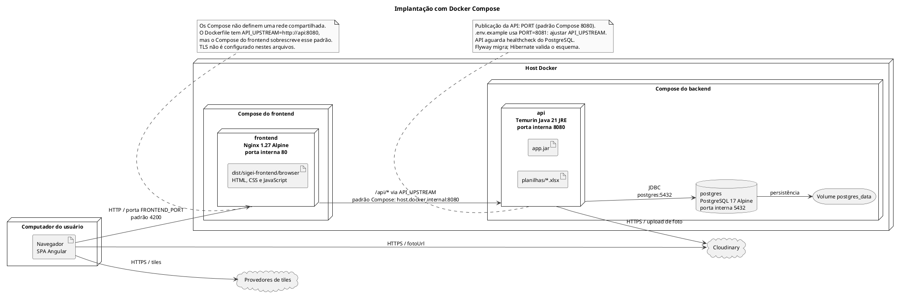

# Implantação com Docker Compose

Topologia descrita pelos arquivos de implantação do repositório, com serviços de frontend e backend em composições separadas.

## Leitura e limites

Variáveis e credenciais são fornecidas pelo ambiente; os diagramas não contêm segredos. O PostgreSQL também publica `POSTGRES_PORT` (padrão 5432) no host. Healthchecks existentes: `/healthz` no frontend e `/actuator/health` na API. O build do Angular usa Node 22; o build Java usa JDK 21 e Maven Wrapper.

## Fontes no projeto

- [docker-compose.yml](../../sigei-backend/docker-compose.yml)
- [Dockerfile](../../sigei-backend/Dockerfile)
- [.env.example](../../sigei-backend/.env.example)
- [compose.yml](../../sigei-frontend/compose.yml)
- [Dockerfile](../../sigei-frontend/Dockerfile)
- [default.conf.template](../../sigei-frontend/nginx/default.conf.template)
