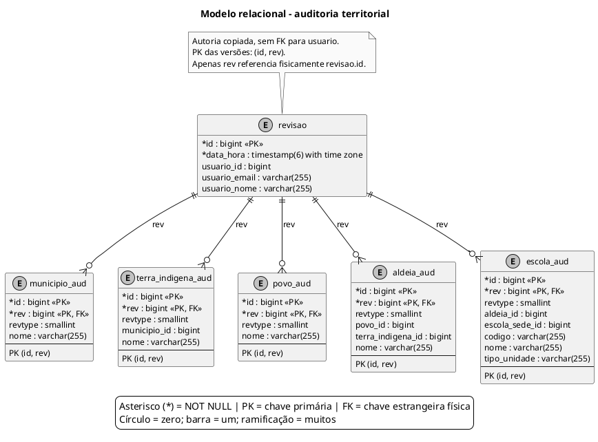

# Modelo relacional - auditoria territorial

Versões das entidades territoriais e das escolas criadas pela migração V4 (Hibernate Envers).

Atualizado em **06/10/2026**, considerando o estado resultante das migrações **V1 a V6** e os mapeamentos atuais das entidades.

## Leitura e limites

**Convenções:** `*` indica coluna obrigatória (NOT NULL, incluindo a chave primária); ausência de `*` indica coluna anulável. `PK` = chave primária; `FK` = chave estrangeira física; `unique`/`UNIQUE` = unicidade. No pé de galinha, círculo = zero, barra = um e ramificação = muitos. Toda FK referencia a coluna `id` da tabela na outra extremidade. Campos de auditoria que apenas copiam identificadores não são marcados como FK.

- Cada linha de auditoria é identificada por **PK (id, rev)**: `id` identifica o objeto versionado e `rev` identifica a revisão. Uma revisão pode conter alterações em várias tabelas; cada linha auditada pertence a exatamente uma revisão.
- Nas tabelas `_aud`, apenas `rev` tem FK física. Os demais identificadores são valores históricos, sem FK para tabelas atuais ou outras tabelas auditadas. Por isso o diagrama não desenha relações físicas para esses campos.
- `revtype` é `smallint` anulável no DDL, com os códigos usados pelo Envers: 0 = criação, 1 = alteração, 2 = exclusão. Não há CHECK desses códigos na V4.
- `revisao.usuario_id`, `usuario_email` e `usuario_nome` são cópias do autor, sem FK. Ausência de autor identifica operações do sistema.
- A V4 cria uma revisão inicial com uma fotografia dos dados existentes. Ela não recupera datas, autores ou alterações anteriores à implantação da auditoria.
- `store_data_at_delete=true` preserva os valores na exclusão. A tabela `revisao` repetida nas figuras 21, 22 e 23 é a mesma tabela física.
- O autor em `revisao` e o campo `escola_aud.escola_sede_id` sobrevivem à exclusão dos registros atuais que identificavam. Não existe `anexo_aud`: a tabela `anexo` foi removida antes da migração de auditoria.

## Fontes no projeto

- [V4__trilha_auditoria.sql](../../sigei-backend/src/main/resources/db/migration/V4__trilha_auditoria.sql)
- [Revisao.java](../../sigei-backend/src/main/java/ac/gov/br/sigei_backend/models/Revisao.java)
- [RevisaoListener.java](../../sigei-backend/src/main/java/ac/gov/br/sigei_backend/config/auditoria/RevisaoListener.java)
- [application.properties](../../sigei-backend/src/main/resources/application.properties)
- [V3__unifica_vinculo_sede_anexo.sql](../../sigei-backend/src/main/resources/db/migration/V3__unifica_vinculo_sede_anexo.sql)
- [Escola.java](../../sigei-backend/src/main/java/ac/gov/br/sigei_backend/models/Escola.java)
