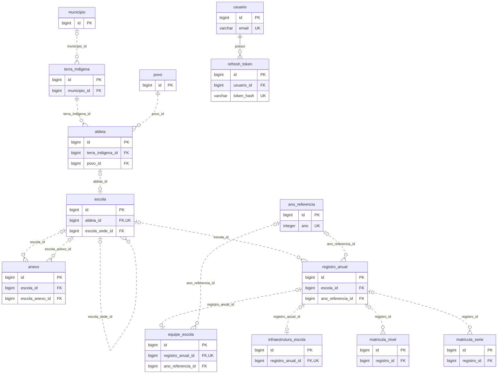

# Banco de dados — SIGEI

Documentação das 13 entidades persistidas da API, com dicionário de dados e diagrama de relacionamentos. Fonte: [entidades JPA](../src/main/java/ac/gov/br/sigei_backend/models) e [configuração da aplicação](../src/main/resources/application.properties).

Este documento descreve o modelo definido no código, sem consultar uma instância do banco. Nomes e tipos SQL abaixo são os esperados para PostgreSQL com a configuração atual. Como `JPA_DDL_AUTO` tem padrão `update`, bancos existentes podem conter diferenças de schema ou objetos antigos. Não é um script de migração nem uma auditoria do banco implantado.

## Convenções

- Tabelas e colunas seguem `snake_case`; por exemplo, `RegistroAnual` → `registro_anual` e `totalAlunos` → `total_alunos`. Não há estratégia de nomes personalizada na configuração atual.
- Todas as tabelas possuem `id`: chave primária `bigint`, não nula, gerada por `GenerationType.IDENTITY`. Esse campo está implícito em cada tabela do dicionário abaixo.
- `Long` → `bigint`, `Integer` → `integer`, `Double` → `double precision`, `Boolean`/`boolean` → `boolean`, `String` → `varchar(255)` na ausência de configuração específica.
- **PK**: chave primária; **FK**: chave estrangeira; **UK**: unicidade.
- “Aceita nulo” descreve o mapeamento de persistência, não as validações do DTO ou do service. Nos booleanos primitivos de equipe, não há `nullable=false` explícito; a coluna física deve ser conferida no DDL, e o objeto Java não representa `null`.
- Coleções com `mappedBy` são o lado inverso da associação: não criam coluna de lista ou tabela intermediária.

## Diagrama de relacionamentos

O [modelo ER completo gerado automaticamente](MODELO_ER.md) inclui todas as colunas e é atualizado com `scripts/gerar-modelo-er.ps1`. O diagrama abaixo é uma visão resumida mantida manualmente.

O diagrama usa Mermaid, com apenas as chaves para manter a leitura simples. Os demais campos estão no dicionário. `||` significa exatamente um, `o|` zero ou um e `o{` zero ou muitos. As cardinalidades refletem a nulabilidade e os relacionamentos JPA atuais, inclusive vínculos opcionais.



As UKs de `aldeia_id` e `registro_anual_id` representam a unicidade esperada dos mapeamentos `@OneToOne`. As unicidades compostas de `anexo` e `registro_anual` estão detalhadas adiante. `usuario` não possui FK para as tabelas do domínio; apenas `refresh_token` referencia `usuario`.

## Dicionário de dados

Todas as tabelas abaixo também possuem a coluna `id` descrita nas convenções.

### `municipio`

Entidade [Municipio.java](../src/main/java/ac/gov/br/sigei_backend/models/Municipio.java). Cadastro de municípios; o inicializador inclui os municípios ausentes do Acre.

| Coluna | Tipo SQL esperado | Aceita nulo | Descrição |
| --- | --- | --- | --- |
| `nome` | `varchar(255)` | Sim | Nome do município. |

### `terra_indigena`

Entidade [TerraIndigena.java](../src/main/java/ac/gov/br/sigei_backend/models/TerraIndigena.java). Cadastro de terras indígenas, vinculadas opcionalmente a um município no mapeamento.

| Coluna | Tipo SQL esperado | Aceita nulo | Descrição |
| --- | --- | --- | --- |
| `nome` | `varchar(255)` | Sim | Nome da terra indígena. |
| `municipio_id` | `bigint` | Sim | FK → `municipio.id`; muitas terras podem referenciar o mesmo município. |

### `povo`

Entidade [Povo.java](../src/main/java/ac/gov/br/sigei_backend/models/Povo.java). Cadastro de povos indígenas.

| Coluna | Tipo SQL esperado | Aceita nulo | Descrição |
| --- | --- | --- | --- |
| `nome` | `varchar(255)` | Sim | Nome do povo. |

`Povo.aldeias` é uma coleção inversa; o vínculo é armazenado em `aldeia.povo_id`.

### `aldeia`

Entidade [Aldeia.java](../src/main/java/ac/gov/br/sigei_backend/models/Aldeia.java). Aldeia vinculada obrigatoriamente a uma terra indígena e um povo.

| Coluna | Tipo SQL esperado | Aceita nulo | Descrição |
| --- | --- | --- | --- |
| `nome` | `varchar(255)` | Sim | Nome da aldeia. |
| `terra_indigena_id` | `bigint` | Não | FK → `terra_indigena.id`. |
| `povo_id` | `bigint` | Não | FK → `povo.id`. |

### `escola`

Entidade [Escola.java](../src/main/java/ac/gov/br/sigei_backend/models/Escola.java). Identidade da unidade escolar, separada dos dados que variam por ano.

| Coluna | Tipo SQL esperado | Aceita nulo | Descrição |
| --- | --- | --- | --- |
| `codigo` | `varchar(255)` | Sim | Código da escola; sem UK declarada na entidade. |
| `nome` | `varchar(255)` | Sim | Nome da escola. |
| `tipo_unidade` | `varchar(255)` | Sim | Tipo da unidade, como `SEDE` ou `ANEXO`; o campo é `String`, não enum persistido. |
| `escola_sede_id` | `bigint` | Sim | FK → `escola.id`; autorrelacionamento muitos-para-um. |
| `aldeia_id` | `bigint` | Sim | FK → `aldeia.id`; associação `@OneToOne`, com unicidade esperada. |

O modelo atual permite no máximo uma escola por aldeia por causa de `@OneToOne`; não documentar esse vínculo como muitos-para-um sem alterar o mapeamento. `Escola.registros` é a coleção inversa de `registro_anual.escola_id`.

### `anexo`

Entidade [Anexo.java](../src/main/java/ac/gov/br/sigei_backend/models/Anexo.java). Vínculo entre uma escola e uma escola anexo; não armazena arquivos.

| Coluna | Tipo SQL esperado | Aceita nulo | Descrição |
| --- | --- | --- | --- |
| `escola_id` | `bigint` | Sim | FK → `escola.id`, escola de referência do vínculo. |
| `escola_anexo_id` | `bigint` | Sim | FK → `escola.id`, escola anexo. |

UK composta: `(escola_id, escola_anexo_id)`. Cada coluna isoladamente aceita repetição; o mapeamento não restringe uma escola anexo a uma única escola de referência. Esse vínculo existe em paralelo a `escola.escola_sede_id`; não há restrição declarada que sincronize as duas representações ou impeça autorreferências/ciclos.

### `ano_referencia`

Entidade [AnoReferencia.java](../src/main/java/ac/gov/br/sigei_backend/models/AnoReferencia.java). Anos usados no histórico escolar.

| Coluna | Tipo SQL esperado | Aceita nulo | Descrição |
| --- | --- | --- | --- |
| `ano` | `integer` | Não | Ano civil, como `2025`; UK. Não confundir com `id`. |

### `registro_anual`

Entidade [RegistroAnual.java](../src/main/java/ac/gov/br/sigei_backend/models/RegistroAnual.java). Centro dos dados históricos de uma escola em um ano.

| Coluna | Tipo SQL esperado | Aceita nulo | Descrição |
| --- | --- | --- | --- |
| `escola_id` | `bigint` | Sim | FK → `escola.id`. |
| `ano_referencia_id` | `bigint` | Sim | FK → `ano_referencia.id`. |
| `rede` | `varchar(255)` | Sim | Rede de ensino. |
| `local_funcionamento` | `varchar(255)` | Sim | Local de funcionamento da unidade naquele ano. |
| `total_alunos` | `integer` | Sim | Total de alunos armazenado no registro. |

UK composta: `(escola_id, ano_referencia_id)`. O par identifica um único registro quando os dois valores estão preenchidos. Os atributos Java `equipe`, `infraestrutura`, `matriculasNivel` e `matriculasSerie` são associações inversas, sem colunas correspondentes nesta tabela.

### `equipe_escola`

Entidade [EquipeEscola.java](../src/main/java/ac/gov/br/sigei_backend/models/EquipeEscola.java). Disponibilidade de profissionais e necessidade de transporte.

| Coluna | Tipo SQL esperado | Aceita nulo | Descrição |
| --- | --- | --- | --- |
| `registro_anual_id` | `bigint` | Sim | FK → `registro_anual.id`; `@OneToOne`, unicidade esperada. |
| `ano_referencia_id` | `bigint` | Sim | FK → `ano_referencia.id`; vínculo adicional muitos-para-um. |
| `tem_professor_responsavel` | `boolean` | Ver nota | Disponibilidade de professor responsável. |
| `tem_equipe_gestora` | `boolean` | Ver nota | Disponibilidade de equipe gestora. |
| `tem_merendeira` | `boolean` | Ver nota | Disponibilidade de merendeira. |
| `tem_zeladora` | `boolean` | Ver nota | Disponibilidade de zeladora. |
| `tem_barqueiro` | `boolean` | Ver nota | Disponibilidade de barqueiro. |
| `necessita_transporte` | `boolean` | Ver nota | Necessidade de transporte. |

Nota: os seis indicadores são `boolean` primitivos, inicializados em `false` pelo Java, sem `@Column(nullable=false)` ou `@ColumnDefault` explícitos. Não confundir esse valor inicial com um default SQL declarado.

O ano também pode ser obtido por `registro_anual.ano_referencia_id`. Não há restrição JPA declarada que obrigue esse ano e `equipe_escola.ano_referencia_id` a coincidirem.

### `infraestrutura_escola`

Entidade [InfraestruturaEscola.java](../src/main/java/ac/gov/br/sigei_backend/models/InfraestruturaEscola.java). Situação física, serviços, localização e fotografia do registro anual.

| Coluna | Tipo SQL esperado | Aceita nulo | Descrição |
| --- | --- | --- | --- |
| `registro_anual_id` | `bigint` | Sim | FK → `registro_anual.id`; `@OneToOne`, unicidade esperada. |
| `ano_construcao` | `integer` | Sim | Ano de construção. |
| `num_salas` | `integer` | Sim | Número de salas. |
| `latitude` | `double precision` | Sim | Latitude. |
| `longitude` | `double precision` | Sim | Longitude. |
| `situacao` | `varchar(255)` | Sim | Situação da escola. |
| `tipo_acesso` | `varchar(255)` | Sim | Tipo de acesso à unidade. |
| `tem_predio` | `boolean` | Sim | Existência de prédio. |
| `tipo_agua` | `varchar(255)` | Sim | Forma de abastecimento de água. |
| `tem_internet` | `boolean` | Sim | Disponibilidade de internet. |
| `tipo_energia` | `varchar(255)` | Sim | Fonte/tipo de energia. |
| `tem_registro_fotografico` | `boolean` | Sim | Existência de registro fotográfico. |
| `foto_url` | `varchar(255)` | Sim | URL da imagem armazenada externamente. |
| `foto_public_id` | `varchar(255)` | Sim | Identificador da imagem no Cloudinary. |

O arquivo de imagem não é persistido como BLOB. Os indicadores `Boolean` permitem distinguir `null` de `false`.

### `matricula_nivel`

Entidade [MatriculaNivel.java](../src/main/java/ac/gov/br/sigei_backend/models/MatriculaNivel.java). Quantidades de matrículas por nível de ensino.

| Coluna | Tipo SQL esperado | Aceita nulo | Descrição |
| --- | --- | --- | --- |
| `registro_id` | `bigint` | Sim | FK → `registro_anual.id`. |
| `nivel` | `varchar(255)` | Sim | Nível de ensino. |
| `qtd_masculino` | `integer` | Sim | Quantidade masculina. |
| `qtd_feminino` | `integer` | Sim | Quantidade feminina. |
| `total` | `integer` | Sim | Total armazenado. |

### `matricula_serie`

Entidade [MatriculaSerie.java](../src/main/java/ac/gov/br/sigei_backend/models/MatriculaSerie.java). Quantidades de matrículas por série/etapa.

| Coluna | Tipo SQL esperado | Aceita nulo | Descrição |
| --- | --- | --- | --- |
| `registro_id` | `bigint` | Sim | FK → `registro_anual.id`. |
| `denominacao` | `varchar(255)` | Sim | Denominação da série. |
| `etapa_ensino` | `varchar(255)` | Sim | Etapa de ensino. |
| `qtd_masculino` | `integer` | Sim | Quantidade masculina. |
| `qtd_feminino` | `integer` | Sim | Quantidade feminina. |
| `total` | `integer` | Sim | Total armazenado. |

Nas duas tabelas de matrícula, não há UK composta por registro e nível/série declarada nas entidades. Os totais são campos persistidos comuns, sem expressão SQL gerada ou restrição declarada que imponha a soma das quantidades. Também não há `CHECK` de valores não negativos declarado nesses campos.

### `usuario`

Entidade [Usuario.java](../src/main/java/ac/gov/br/sigei_backend/models/Usuario.java). Contas de acesso à API, sem relacionamento JPA com escolas ou municípios.

| Coluna | Tipo SQL esperado | Aceita nulo | Descrição |
| --- | --- | --- | --- |
| `nome` | `varchar(255)` | Não | Nome do usuário. |
| `email` | `varchar(255)` | Não | E-mail de autenticação; UK. |
| `senha` | `varchar(255)` | Não | Hash BCrypt; não é senha em texto puro. |
| `perfil` | Representação textual de enum | Não | `@Enumerated(EnumType.STRING)`: `ADMIN` ou `USUARIO`; tipo/constraint SQL final depende do Hibernate/dialeto. |
| `ativo` | `boolean` | Não | Inicializado em `true` no Java, sem default SQL explícito. |
| `alterar_senha` | `boolean` | Não | Inicializado em `true` no Java e com `@ColumnDefault("true")`. |

Não há tabela separada para os perfis no modelo atual.

### `refresh_token`

Entidade [RefreshToken.java](../src/main/java/ac/gov/br/sigei_backend/models/RefreshToken.java). Sessões renováveis emitidas no login e em `POST /auth/refresh`. O token JWT de acesso não é persistido.

| Coluna | Tipo SQL esperado | Aceita nulo | Descrição |
| --- | --- | --- | --- |
| `usuario_id` | `bigint` | Não | FK → `usuario.id`, com `ON DELETE CASCADE` (`@OnDelete`). |
| `token_hash` | `varchar(64)` | Não | Hash SHA-256 (hexadecimal) do token entregue ao cliente; UK. O valor original não é gravado. |
| `criado_em` | `timestamp` | Não | Momento da emissão. |
| `expira_em` | `timestamp` | Não | Fim da validade (`jwt.refresh-expiration`). |
| `revogado` | `boolean` | Não | `true` após uso (rotação), logout, troca de senha ou detecção de reutilização. |
| `revogado_em` | `timestamp` | Sim | Momento da revogação; distingue concorrência entre abas (até 30 s) de reutilização suspeita. |

Tokens revogados são mantidos para detectar reutilização; os expirados de um usuário são apagados quando ele recebe um novo token.

## Cascatas e exclusões

| Associação no Java | Configuração | Efeito no ciclo de vida JPA |
| --- | --- | --- |
| `Escola.registros` | `CascadeType.ALL`, `orphanRemoval=true` | Operações são propagadas aos registros anuais; remover um registro da coleção pode excluí-lo. |
| `RegistroAnual.equipe` | `CascadeType.ALL`, `orphanRemoval=true` | Equipe acompanha o ciclo de vida do registro; desvinculá-la pode removê-la. |
| `RegistroAnual.infraestrutura` | `CascadeType.ALL`, `orphanRemoval=true` | Infraestrutura acompanha o ciclo de vida do registro. |
| `RegistroAnual.matriculasNivel` | `CascadeType.ALL`, `orphanRemoval=true` | Propagação às matrículas por nível e exclusão de órfãos. |
| `RegistroAnual.matriculasSerie` | `CascadeType.ALL`, `orphanRemoval=true` | Propagação às matrículas por série e exclusão de órfãos. |

As demais associações não declaram cascata de remoção. Por exemplo, excluir um povo não implica excluir suas aldeias automaticamente. Referências existentes podem impedir exclusões.

Essas cascatas são do ORM: não equivalem a `ON DELETE CASCADE` no PostgreSQL. A única exceção é `refresh_token.usuario_id`, que declara `@OnDelete(CASCADE)`: excluir um usuário remove seus tokens no próprio banco. Exclusões por SQL direto ou operações em lote podem ter comportamento diferente das operações de entidade. A remoção de uma linha de infraestrutura também não descreve, por si só, a remoção do arquivo no Cloudinary.

## Como manter esta documentação

Ao alterar uma entidade, revise sua tabela, campos, nulabilidade, FK, UK, cardinalidade e cascatas neste documento. A inclusão de um campo em um DTO não implica automaticamente uma nova coluna.

Para conferir uma instância real, use o catálogo do banco ou a ferramenta de banco da IDE. Exemplo de consultas somente de leitura no PostgreSQL, substituindo `public` caso outro schema seja usado:

```sql
-- Colunas, tipos físicos, nulabilidade, defaults e identidade.
SELECT table_name, column_name, data_type, udt_name,
       character_maximum_length, is_nullable, column_default, is_identity
FROM information_schema.columns
WHERE table_schema = 'public'
ORDER BY table_name, ordinal_position;

-- Chaves e restrições efetivamente presentes, inclusive ações das FKs.
SELECT t.relname AS tabela, c.conname AS restricao,
       c.contype AS tipo, pg_get_constraintdef(c.oid) AS definicao
FROM pg_constraint c
JOIN pg_class t ON t.oid = c.conrelid
JOIN pg_namespace n ON n.oid = t.relnamespace
WHERE n.nspname = 'public'
ORDER BY t.relname, c.conname;
```

Essas consultas não foram executadas para produzir este documento. Não foram adicionadas migrações, alteradas entidades ou criados endpoints de documentação.
