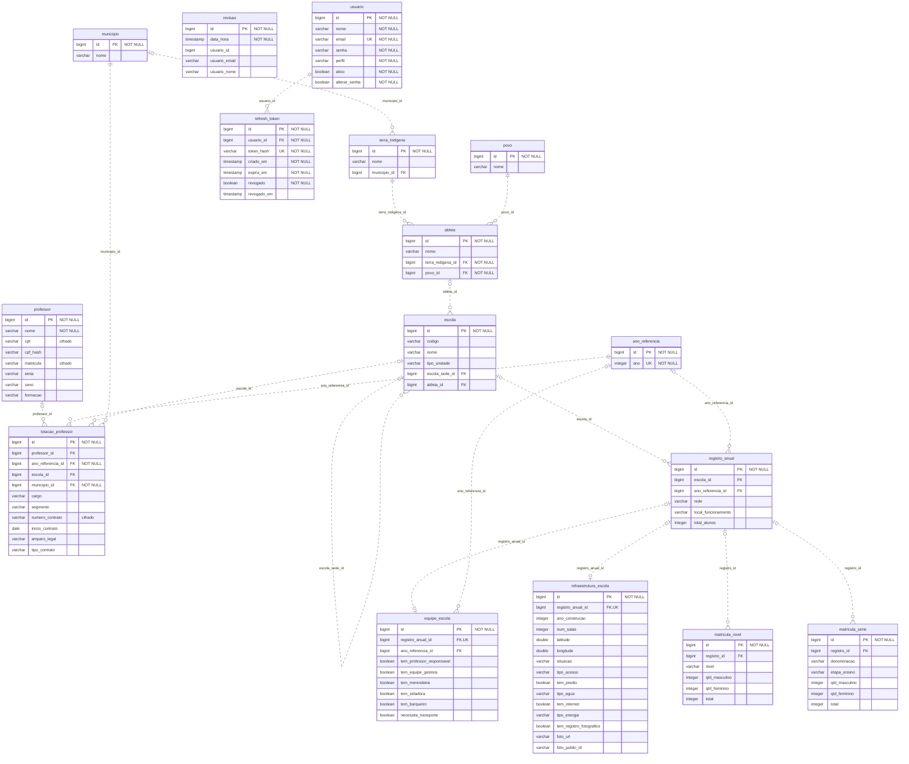

# Modelo ER gerado das entidades JPA

Gerado por `scripts/gerar-modelo-er.ps1`. Nao editar manualmente este arquivo.

Modelo esperado a partir do codigo, sem consultar o banco. Tipos SQL simplificados; `double` representa `double precision`. PK = chave primaria, FK = chave estrangeira, UK = unicidade. As UKs de associacoes um-para-um sao inferidas do mapeamento JPA.

Cardinalidades: `||` exatamente um; `o|` zero ou um; `o{` zero ou muitos. Campos marcados NOT NULL possuem restricao explicita ou sao PK. Demais campos nao recebem garantia de nulabilidade neste diagrama.

## Unicidades compostas

- `professor`: UNIQUE (cpf_hash).
- `registro_anual`: UNIQUE (escola_id, ano_referencia_id).

Descricoes e regras de exclusao: [dicionario do banco](BANCO_DE_DADOS.md).
